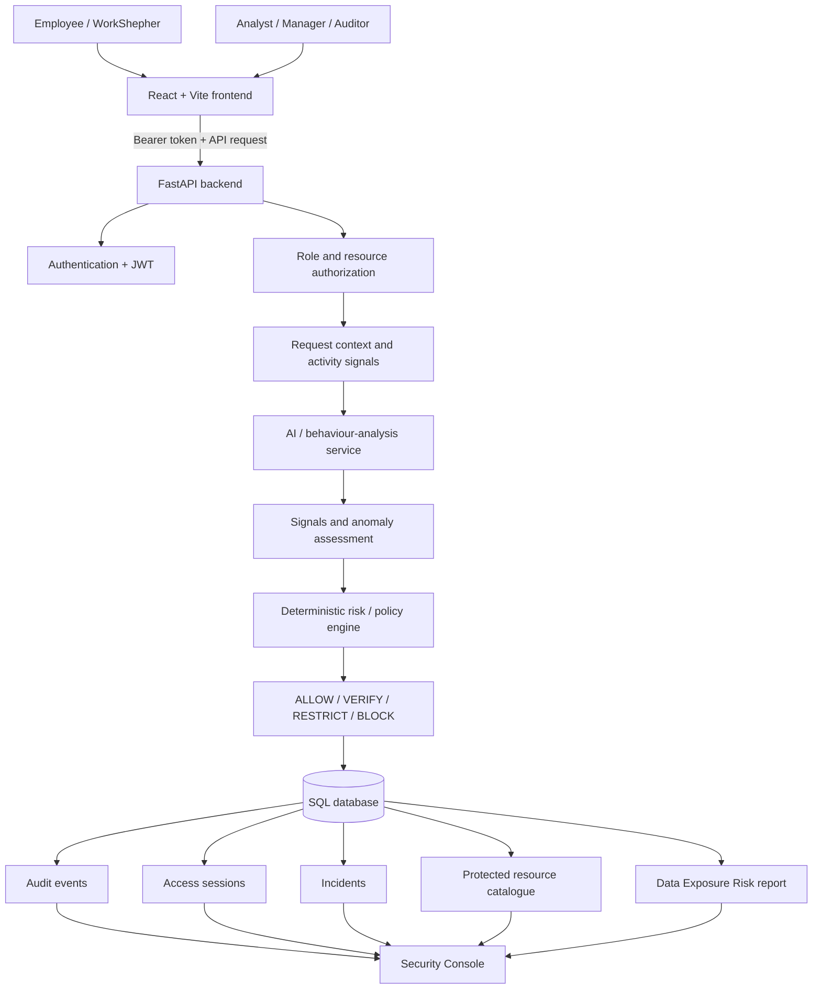

<div align="center">

# 🛡️ DataTripwire

### Zero-Trust Engine Based on Continuous User Behavior

**_A valid login should never become unlimited trust._**

*Keep checking users after login, not just once.*


**Presented by Team YOKAI · AGNITIA 2026 · Prestige Institute of Engineering and Management and Research, Indore**

</div>

---

## 📑 Table of Contents

1. [Overview](#-overview)
2. [The Problem](#-the-problem)
3. [Our Solution](#-our-solution)
4. [What Makes DataTripwire Different](#-what-makes-datatripwire-different)
5. [Key Features](#-key-features)
6. [Implementation Status (Honest Scorecard)](#-implementation-status-honest-scorecard)
7. [System Architecture](#-system-architecture)
8. [How a Request Is Evaluated](#-how-a-request-is-evaluated)
9. [Adaptive Response Ladder & Policy Engine](#-adaptive-response-ladder--policy-engine)
10. [AI & Behavioural Analysis](#-ai--behavioural-analysis)
11. [Data Exposure Risk Module](#-data-exposure-risk-module)
12. [Tech Stack](#-tech-stack)
13. [Application Map](#-application-map)
14. [Data Model](#-data-model)
15. [API Reference](#-api-reference)
16. [Installation & Setup](#-installation--setup)
17. [Usage & Live Demo Script](#-usage--live-demo-script)
18. [Project Structure](#-project-structure)
19. [Testing & Acceptance Checklist](#-testing--acceptance-checklist)
20. [Privacy & Security Design](#-privacy--security-design)
21. [Feasibility & Viability](#-feasibility--viability)
22. [Known Limitations & Integration Risks](#-known-limitations--integration-risks)
23. [Roadmap](#-roadmap)
24. [Contributing](#-contributing)
25. [License](#-license)
26. [References & Acknowledgements](#-references--acknowledgements)
27. [Team & Contact](#-team--contact)

---

## 🎯 Overview

**DataTripwire** is a Zero-Trust enterprise security platform built for one specific, widely exploited gap: **valid credentials being misused after login.**

Traditional systems authenticate a user once, check a static role, and then trust the session too broadly. DataTripwire treats login as the *start* of evaluation, not the end. Every protected request is assessed against the user's identity, role, responsibility, current task, resource sensitivity, device/location/time context and activity patterns. The system then makes a **proportionate, explainable, auditable** decision.

> **Authentication asks:** *"Are these credentials valid?"*
> **DataTripwire adds:** *"Is this activity still trustworthy?"*

> *Identity tells us who you are. DataTripwire decides whether your current activity should still be trusted.*

**Track / Problem Statement:** CIPHER, Cybersecurity & Digital Trust, **DataTripwire: Responsibility-Aware Continuous Data Trust & Adaptive Threat Containment.**

The platform has two connected experiences:

| Experience | Audience | Purpose |
|---|---|---|
| 🧑‍💼 **WorkShepher Workspace** | Employees | Realistic work platform: dashboard, tasks, projects, documents, reports, approvals, team, calendar, messages, profile, settings |
| 🕵️ **DataTripwire Security Console (SOC)** | Security managers, analysts, auditors | Overview, live activity, user risk, sessions, resources, incidents, policy engine, RBAC governance, audit logs, adaptive response, AI Copilot, health, settings |

Everyday employee actions in WorkShepher flow through the security engine and become **auditable evidence** in the SOC.

---

## 🚨 The Problem

**Valid credentials do not guarantee trustworthy activity.** An organisation can authenticate a user successfully and still fail to detect misuse of a legitimate account after compromise. This maps directly to **MITRE ATT&CK T1078 (Valid Accounts)**.

### Attack progression

```text
 ┌──────────────┐   ┌───────────────┐   ┌────────────────┐   ┌────────────────┐   ┌──────────────────┐
 │ 01 Stolen    │ → │ 02 Valid      │ → │ 03 Recon-      │ → │ 04 Data        │ → │ 05 Misuse /      │
 │ Credentials  │   │ Authenticated │   │ naissance      │   │ Discovery      │   │ Exfiltration     │
 │              │   │ Session       │   │                │   │                │   │                  │
 └──────────────┘   └───────────────┘   └────────────────┘   └────────────────┘   └──────────────────┘
  Attacker obtains   Signs in            Explores internal    Identifies           Steals, modifies
  valid employee     legitimately        systems              sensitive resources  or misuses data
  credentials
```

### The core gap: `VALID CREDENTIALS ≠ CONTINUOUS TRUST`

| Why existing controls struggle | Explanation |
|---|---|
| **Authentication** | Proves identity at one point in time, not every later action. |
| **Static roles (RBAC)** | Define what a role *may* do, but don't capture current responsibility or assigned task. |
| **Signals alone** | A new device, odd hours, or a high request rate can all be perfectly legitimate, so single indicators cause false positives. |

### Threats the design addresses

- Stolen or compromised credentials
- New or unfamiliar device / location
- Access at unusual times
- Abnormally high request rates
- Broad resource enumeration
- Repeated authorization failures
- Cross-domain access patterns
- High download volume (when telemetry is supplied)
- Actions outside task/responsibility context
- Suspicious access to confidential/restricted resources
- Rising sensitive-data access/download/copy/export activity
- Interaction with a deception/decoy resource (when the environment supplies that signal)

### Who is affected

Employees · Security analysts / SOC · IT & identity admins · Data owners & app admins

**Impact chain:** Compromised account → unauthorized data access → data exposure → investigation burden.

---

## 💡 Our Solution

DataTripwire converts a user from **Authenticated** to **Continuously Trusted** by fusing seven context signals:

| Signal | Question it answers |
|---|---|
| 🪪 **Identity** | Who is the user? |
| 📋 **Responsibility** | What are they responsible for? |
| ✅ **Current Task** | What are they doing right now? |
| 🔑 **Capability** | What can they do? |
| 📈 **Behaviour** | Is it normal? |
| 🗂️ **Data Sensitivity** | What data is being touched? |
| 🪤 **Deception** | Are they touching a decoy? |

**Unique value proposition:** *A successful login does not create unlimited trust. Access continuously reflects responsibility, capability, behaviour and data sensitivity.*

### Three-part system

```text
 ┌───────────────────────┐     ┌──────────────────────────┐     ┌───────────────────────────┐
 │      WORKSHEPHER      │     │       DATATRIPWIRE       │     │     DATATRIPWIRE SOC      │
 │  Employee work &      │ ──▶ │  Continuous data trust & │ ──▶ │  Security manager &       │
 │  responsibility app   │     │  threat detection engine │     │  response console         │
 └───────────────────────┘     └──────────────────────────┘     └───────────────────────────┘
```

> ### 🧠 Design principle: **AI recommends. The policy engine enforces.**
> AI explains and correlates; it **never** revokes access itself. Enforcement is performed by a deterministic backend policy engine, so every decision traces back to recorded evidence and a policy outcome, and the system still enforces safely if the AI service is unavailable.

---

## 🌟 What Makes DataTripwire Different

> **Judging lens: originality · impact · technical complexity · execution**

| # | Differentiator | Why it matters |
|---|---|---|
| 1 | **Continuous contextual trust** | A login starts evaluation instead of ending it. Each protected request is re-assessed using identity, role, sensitivity, device/location/time novelty, activity rate, resource breadth, auth failures and task/responsibility alignment. |
| 2 | **Enforcement, not just alerting** | The decision engine maps risk and resource sensitivity to `ALLOW / VERIFY / RESTRICT / BLOCK`, then writes an audit event, updates session state and opens an incident for restrict/block outcomes. |
| 3 | **Explainable decisions** | Every decision carries a score, severity, contributing signals and a plain-language explanation, so analysts can see *why* access was allowed, challenged, restricted or blocked. |
| 4 | **Responsibility-aware authorization** | `Role + Responsibility + Task + Resource + Action + Scope`, enforced **server-side**. An employee may view records assigned to a task but not enumerate unrelated ones. |
| 5 | **Evidence fusion** | Authorization context, behaviour, resource sensitivity and deception events are combined rather than relying on one indicator, so responses stay *explainable and proportionate* and false lockouts are reduced. |
| 6 | **Separate behaviour risk and data-exposure risk** | A user with a familiar device, location and login time can still be flagged when sensitive downloads/exports rise. This gives a real insider-risk story beyond login-anomaly detection. |
| 7 | **Controlled adaptive deception** | An approved *synthetic* decoy is exposed on a policy trigger. Touching it is a high-confidence signal correlated with session and activity evidence. |
| 8 | **Dual threat scoring (STS / ATS)** | Session Threat Score rates one authenticated session; Asset Threat Score flags activity on a protected asset, so several sessions hitting one asset reveal an *asset-focused* attack. |
| 9 | **Reversible containment** | Every response step is logged, reviewable and restorable. Quarantine is temporary, never a permanent lockout. |
| 10 | **Fail-safe by design** | AI is advisory only. If it fails, deterministic policy still decides. Protected access fails *closed*. |
| 11 | **Persisted evidence** | Decisions are demonstrated through real audit / session / incident records, not UI colour changes. |
| 12 | **Work context informs security** | Task and responsibility matching turns a productivity tool into a source of security signal. |

---

## ✨ Key Features

### 01 · Responsibility-Aware Authorization
Server-side enforcement of role, responsibility, task, resource, action and scope. Supported actions: `VIEW`, `DOWNLOAD`, `SHARE`, `EDIT`. RBAC denials are audited and returned.

### 02 · Continuous Behaviour Analysis
Tracks request volume, repeated record enumeration, unusual access sequences, unique resources, records accessed, authorization failures, cross-domain access and data-volume changes. *An anomaly is evidence for risk assessment, not proof of an attacker.*

### 03 · AI-Assisted Security Intelligence
Anomaly analysis, event correlation, incident summaries and attack-sequence reconstruction. **Advisory only**: it cannot revoke access, and the system fails safely if it is down. Includes an analyst-facing **AI Copilot** page in the SOC.

### 04 · Controlled Adaptive Deception
On a policy trigger, an approved synthetic decoy is exposed via a controlled path. A decoy interaction is treated as a high-confidence event (`deception_interaction` / `decoy_access` signals).

### 05 · Dual Threat Scoring (STS / ATS)
- **STS** (Session Threat Score): risk in one authenticated session.
- **ATS** (Asset Threat Score): suspicious activity on a protected asset. Multiple sessions hitting one asset suggest an asset-focused attack.

### 06 · Adaptive, Reversible Containment
`Allow → Monitor → Verify → Restrict → Temporary Quarantine`, with every step logged, reviewable and restorable. Database-level protection is shown only in a safe simulation.

### 07 · Data Exposure Risk Report
Per-user, explainable heuristic comparing sensitive-resource access/download/copy/export activity across the current window and the preceding equal-length window, with severity and trend. See [details](#-data-exposure-risk-module).

### 08 · Full SOC Console
Overview · Live Activity · Users Risk · Sessions · Resources · Incidents · Policy Engine · RBAC/Access Governance · Audit Logs · Adaptive Response · AI Copilot · System Health · Security Settings.

### 09 · Employee Workspace (WorkShepher)
Persisted per-user workspace state covering tasks, projects, documents, approvals, team, calendar, messages, profile and settings. Workspace actions generate audit events.

---

## 📊 Implementation Status (Honest Scorecard)

We believe judges value transparency. This table separates what is built from what is designed.

| Capability | Status | Notes |
|---|---|---|
| JWT authentication, Argon2 password hashing, `/auth/me` | ✅ Implemented | Seeded demo accounts for local use |
| Server-side RBAC (roles, resources, required roles) | ✅ Implemented | Denials are audited |
| Protected-resource access flow (RBAC → AI → policy → audit → session → incident) | ✅ Implemented (backend branch) | Fail-closed if AI is unavailable |
| Deterministic decision engine (`ALLOW / VERIFY / RESTRICT / BLOCK`) | ✅ Implemented | Default thresholds 50 / 70 / 85, sensitivity-adjusted |
| Audit events, sessions, incidents, policies, resources persisted | ✅ Implemented | SQLAlchemy 2 async |
| Security Console API (overview, activity, incidents, audit, sessions, resources, policies, responses) | ✅ Implemented | Role-guarded |
| Workspace API and WorkShepher UI | ✅ Implemented | Some pages are prototype-oriented |
| Security Console UI (13 routes) | ✅ Implemented | Some overview widgets use sample values (see [limitations](#-known-limitations--integration-risks)) |
| AI behaviour service (FastAPI) with heuristic signal weights + fallback | ✅ Implemented | Isolation Forest path runs only when activity telemetry is present |
| Data Exposure Risk (API contract + React panel) | 🟡 In progress / on feature branches | Frontend and backend contract live on separate branches |
| STS / ATS dual scoring | 🟡 Designed / in progress | Reason-code and score fusion in the engine design |
| Controlled adaptive deception (decoy exposure) | 🟡 Designed / signal supported | Backend accepts `deception_interaction`; decoy exposure flow is demo-scenario level |
| Temporary reversible quarantine | 🟡 Simulated | `BLOCK` + reversible response endpoints; DB-level protection is simulation only |
| Resource sensitivity metadata store | 🔵 Pending | |
| Enterprise IAM / SSO, SIEM, DB audit streams, centralised telemetry | ⚪ Planned | Phase 2 |

> Legend: ✅ implemented · 🟡 in progress / unverified end-to-end · 🔵 pending · ⚪ planned

---

## 🏗️ System Architecture



### Components

| Component | Responsibility |
|---|---|
| **React / Vite frontend** | Login, route navigation, workspace and SOC screens, visualisation, API requests, loading/error feedback |
| **FastAPI backend** | Authentication, authorization, protected access, policy decisions, workspace APIs, audit/session/incident persistence |
| **SQLAlchemy async data layer** | ORM mapping, async sessions, database access |
| **Database** | Users, roles, resources, sessions, events, incidents, policies, workspace state |
| **AI / behaviour service** | Signal interpretation and behaviour/anomaly analysis |
| **Deterministic decision engine** | Maps score, sensitivity and thresholds to an enforcement action |
| **Data Exposure Risk report** | Read-only per-user heuristic across two time windows |
| **Docker Compose / scripts** | Separate container deployment path |

### Zero-Trust Decision Engine (conceptual layers)

| Layer | Contents |
|---|---|
| **Context & Responsibility** | User identity · assigned responsibility · current task context · resource sensitivity |
| **Behaviour & Exposure** | Access-pattern deviation · sensitive-resource access · cumulative data exposure · enumeration signals |
| **Risk & Evidence Fusion** | STS + ATS scores · evidence & reason codes · deception (decoy) signal · backend-provided signals |
| **Deterministic Policy** | Allow · Monitor · Verify · Restrict · Quarantine* |

\*Quarantine only where supported.

---

## 🔄 How a Request Is Evaluated

**End-to-end 8-step pipeline:**

```text
 1 Employee action → 2 Context & responsibility check → 3 Server-side authorization
 → 4 Activity & sensitivity evidence → 5 Behaviour / exposure risk assessment
 → 6 Policy decision → 7 Enforcement & audit trail → 8 SOC review
```

**Protected-resource access (`POST /api/v1/resources/{resource_id}/access`):**

1. Locate the requested resource.
2. Check role/resource authorization.
3. On RBAC denial → record an audit event and return a denial.
4. If the resource is protected → send the context/activity payload to the AI service.
5. If the AI service is unavailable → return a service error (**fail-closed** for protected access).
6. Apply the deterministic decision engine using anomaly score, sensitivity, signals and thresholds.
7. Record an audit event.
8. Create/update session state.
9. Create an incident for `RESTRICT` / `BLOCK` outcomes.
10. Update the resource access count and commit.
11. Return decision, risk score, severity, result, IDs, explanation and analysis.

### Request context fields

| Group | Fields |
|---|---|
| **Action** | `VIEW`, `DOWNLOAD`, `SHARE`, `EDIT` |
| **Session** | Session ID |
| **Context flags** | New device · new location · unusual time |
| **Activity** | Requests/minute · unique resources · records accessed · download volume (MB) · authorization failures · cross-domain access |
| **Work context** | `task_match` · `responsibility_match` · `deception_interaction` |

---

## 🪜 Adaptive Response Ladder & Policy Engine

```text
  ALLOW  ──▶  MONITOR  ──▶  VERIFY  ──▶  RESTRICT  ──▶  QUARANTINE (temporary, logged, reversible)
 (normal)   (watch)       (step-up)    (limit        (contain)         │
                                        capability)                    ▼
                                                                 SOC REVIEW
                                                         (investigate; restore or keep restriction)
```

**Default policy thresholds** (configurable via the Policy Engine):

| Action | Default score threshold |
|---|---|
| `VERIFY` | ≥ **50** |
| `RESTRICT` | ≥ **70** |
| `BLOCK` (temporary containment) | ≥ **85** |

- Score is bounded to **0–100**.
- A **sensitivity adjustment** is added for `CONFIDENTIAL` / `RESTRICTED` resources.
- A score is a **heuristic risk indicator, not a probability** of maliciousness.

**Seeded sample policies:** *High Risk Containment · Critical Session Quarantine · Step-up Verification · Normal Baseline Access.*

---

## 🤖 AI & Behavioural Analysis

The AI service (FastAPI + Python, scikit-learn) analyses behaviour and returns signals plus an anomaly assessment.

**Signals represented**

`new_device` · `new_location` · `unusual_login_time` · `high_request_volume` · `unusual_resource` · `unusual_action` · `scope_violation` · `decoy_access` · authorization-failure signals · `cross_domain_access` · `resource_enumeration` · `high_download_volume` · `task_mismatch` · `responsibility_mismatch` · `sensitive_resource_access` · `deception_interaction`

**Scoring approach**

- **Heuristic signal weights** form the always-available baseline.
- A conditional **Isolation Forest** anomaly-analysis path runs **only when activity telemetry is present**, and the response states whether it ran.
- **Fail-safe:** AI fallback code exists, and protected access fails closed if analysis is unavailable.
- **Explainability:** AI output is checked against recorded evidence; AI explanations can be wrong, so they never act alone.

> We intentionally do **not** claim a production-trained model, calibrated probabilities, or validated false-positive/false-negative rates. This is a hackathon MVP running on synthetic data.

---

## 📉 Data Exposure Risk Module

A separate, read-only, **explainable** report that surfaces insider-risk patterns login-anomaly detection would miss.

**Endpoint:** `GET /api/v1/security/data-exposure?window=7d&limit=50` (Bearer token)

| Parameter | Values | Default |
|---|---|---|
| `window` | `24h`, `7d`, `30d` | `7d` |
| `limit` | `1`–`100` | `50` |

**Status codes:** `200` success · `400` invalid window/limit · `401` unauthenticated · `403` insufficient permission · `500` report-load failure.

**Per-user response includes:** `user_id`, `username`, `role` · `current` and `previous` blocks (each with `metrics`, `data_exposure_risk`, `severity`, `factors[]`) · `trend.direction` and `trend.activity_signal_delta` · `last_event_at`.

**Metrics:** `sensitive_access_count` · `sensitive_download_count` · `sensitive_copy_count` · `sensitive_export_count` · `sensitive_bulk_download_count` · `unique_sensitive_resources` · `recorded_bytes` · `byte_volume_status`

**Scoring and trend**

| Item | Detail |
|---|---|
| Score range | 0–100 |
| Severity | `LOW` (<30) · `MEDIUM` (30–49) · `HIGH` (50–69) · `CRITICAL` (70+) |
| Trend | `NO_ACTIVITY` · `RISING` · `DECLINING` · `STABLE` (current window vs. preceding equal-length window) |
| Factors | Each carries a code, points and explanatory detail |

**Event matching:** normalised `RESOURCE_ACCESS` events matched to a trusted resource-catalogue entry with sensitivity `CONFIDENTIAL` or `RESTRICTED`. Movement actions recognised: `DOWNLOAD`, `COPY`, `EXPORT` / `API_EXPORT`, `BULK_DOWNLOAD`.

**Honest telemetry boundary:** byte-volume telemetry is **not captured**. The API returns `recorded_bytes: null` / `byte_volume_status: NOT_CAPTURED`, and the UI shows **"Not captured"**, never `0 B`. We do **not** claim USB, clipboard, cloud-upload, endpoint-DLP or network-packet detection.

**Frontend (`DataExposureRisk.jsx`):** all three windows, current/previous score and metrics, severity, trend, factors, last event time, loading/error/empty states, and a clearly labelled **dev-only demo fixture** (`VITE_DATA_EXPOSURE_DEMO=true`). Mounted on the Security Overview.

---

## 🧰 Tech Stack

| Layer | Technologies |
|---|---|
| **Frontend** | React 19 · JavaScript/JSX (ES modules) · Vite 7 · React Router 7 · `lucide-react` · Motion for React · CSS (responsive) · Fetch-based API helper with bearer-token handling |
| **Backend** | Python 3.11+ · FastAPI · Uvicorn · Pydantic & Pydantic Settings · SQLAlchemy 2 (async) · PyJWT · `pwdlib[argon2]` · `httpx` |
| **AI / ML** | Python · FastAPI microservice · scikit-learn (Isolation Forest anomaly path) · heuristic signal weights · deterministic fallback |
| **Database** | SQLite + `aiosqlite` (local default) · PostgreSQL (Docker Compose) |
| **Testing** | pytest · pytest-asyncio · httpx |
| **API docs** | OpenAPI / Swagger (`/docs`) |
| **DevOps** | Docker Compose · GitHub Actions CI |

---

## 🗺️ Application Map

### 🧑‍💼 WorkShepher Workspace

| Route | Module |
|---|---|
| `/login` | WorkShepher-branded login (email/password, visibility toggle, loading/error states, role-based redirect) |
| `/` | Dashboard |
| `/tasks` | Tasks (create/update) |
| `/projects` | Projects |
| `/documents` | Documents |
| `/reports` | Reports |
| `/approvals` | Approvals (approve / reject / return) |
| `/team` | Team |
| `/calendar` | Calendar |
| `/messages` | Messages |
| `/profile` | Profile |
| `/settings` | Settings |

### 🕵️ Security Console (SOC)

| Route | Module |
|---|---|
| `/security` | Overview + Data Exposure Risk panel |
| `/security/activity` | Live Activity |
| `/security/users` | Users Risk |
| `/security/sessions` | Sessions: risk and decisions |
| `/security/resources` | Resource catalogue and protection state |
| `/security/incidents` | Incident review and status changes |
| `/security/policy` | Policy Engine |
| `/security/rbac` | RBAC / Access Governance |
| `/security/audit` | Audit Logs |
| `/security/response` | Adaptive Response |
| `/security/copilot` | AI Copilot |
| `/security/health` | System Health |
| `/security/settings` | Security Settings |

> `AuthGate` redirects unauthenticated users to `/login`. Frontend role checks are convenience only: **the backend is the real security boundary.**

---

## 🗄️ Data Model

| Table | Purpose |
|---|---|
| `users` | Identity, email, password hash, active status, created/last login |
| `roles` | Role name and description |
| `user_roles` | Many-to-many user ↔ role association |
| `resources` | Type, sensitivity, owner, required roles, protected flag, access count |
| `access_sessions` | Session ID, user, risk score, decision, status, last seen |
| `audit_events` | Actor/session, action, resource, sensitivity, risk, decision/result/severity, explanation/signals, timestamp |
| `incidents` | Incident/event/user IDs, title, severity, score, status, trigger, resource, timestamp |
| `policies` | Policy ID, name, effect, threshold, scope, enabled flag, version |
| `workspace_states` | Per-user workspace state and update timestamp |

### Seed data (development only)

| Item | Value |
|---|---|
| Roles | Employee · Security Manager · Security Analyst |
| Sample resources | Financial Report *(Confidential)* · HR Records *(Restricted)* · Payroll Sheet *(Restricted)* · Product Roadmap *(Internal)* |
| Sample policies | High Risk Containment · Critical Session Quarantine · Step-up Verification · Normal Baseline Access |

---

## 📡 API Reference

Interactive docs at **`/docs`** (Swagger/OpenAPI). Health: `GET /health`, `GET /ready`, `GET /`.

<details>
<summary><b>🔐 Auth</b></summary>

| Method | Endpoint | Purpose |
|---|---|---|
| POST | `/api/v1/auth/login` | Authenticate and return a bearer token |
| GET | `/api/v1/auth/me` | Current user summary |

</details>

<details>
<summary><b>🛡️ Resources & Protected Access</b></summary>

| Method | Endpoint | Purpose |
|---|---|---|
| GET | `/api/v1/resources` | List resource catalogue for the authenticated user |
| POST | `/api/v1/resources/{resource_id}/access` | Evaluate a protected access request |

</details>

<details>
<summary><b>🕵️ Security Console</b></summary>

| Method | Endpoint | Purpose |
|---|---|---|
| GET | `/api/v1/security/overview` | Overview metrics |
| GET | `/api/v1/security/activity` | Activity / audit events |
| GET | `/api/v1/security/incidents` | Incident list |
| PATCH | `/api/v1/security/incidents/{incident_id}` | Update incident status |
| GET | `/api/v1/security/audit` | Audit events |
| GET | `/api/v1/security/sessions` | Session list |
| PATCH | `/api/v1/security/sessions/{session_id}` | Update session decision/state |
| GET | `/api/v1/security/resources` | Security resource list |
| PATCH | `/api/v1/security/resources/{resource_id}` | Change protection state |
| GET | `/api/v1/security/policies` | Policy list |
| PATCH | `/api/v1/security/policies/{policy_id}` | Change policy state/threshold |
| POST | `/api/v1/security/responses/{session_id}` | Apply a response decision |
| GET | `/api/v1/security/data-exposure?window=7d&limit=50` | Data Exposure Risk report |

</details>

<details>
<summary><b>👥 Admin (Security Manager / Analyst only)</b></summary>

| Method | Endpoint | Purpose |
|---|---|---|
| GET | `/api/v1/admin/users` | List users |
| GET | `/api/v1/admin/roles` | List roles and user counts |

</details>

<details>
<summary><b>💼 Workspace</b></summary>

| Method | Endpoint | Purpose |
|---|---|---|
| GET / PUT | `/api/v1/workspace/state` | Read / update workspace state |
| POST | `/api/v1/workspace/actions` | Record a workspace action (creates audit event) |
| POST | `/api/v1/workspace/tasks` | Create task |
| PATCH | `/api/v1/workspace/tasks/{item_id}` | Update task |
| POST | `/api/v1/workspace/messages` | Send/store message |
| POST | `/api/v1/workspace/approvals/{item_id}/{decision}` | Approve / reject / return |
| PUT | `/api/v1/workspace/profile` | Update profile |
| PUT | `/api/v1/workspace/settings` | Update preferences |

</details>

**Example: protected access request**

```bash
curl -X POST http://127.0.0.1:8000/api/v1/resources/<resource_id>/access \
  -H "Authorization: Bearer <token>" \
  -H "Content-Type: application/json" \
  -d '{
        "action": "DOWNLOAD",
        "session_id": "demo-session-1",
        "new_device": true,
        "unusual_time": true,
        "requests_per_minute": 120,
        "unique_resources": 25,
        "task_match": false
      }'
# → decision (ALLOW|VERIFY|RESTRICT|BLOCK), risk score, severity, signals, explanation
```

> Field names above are illustrative; confirm the exact schema in `/docs` for the branch you run.

---

## ⚙️ Installation & Setup

### Prerequisites

- **Node.js** + npm
- **Python 3.11+**
- **Git**
- *(Optional)* **Docker Desktop** for the container path

### 1. Clone

```bash
git clone https://github.com/devrajshrivastavalforthegame/DataTripwire-Zerotrust-engine.git
cd DataTripwire-Zerotrust-engine
# Check out the branch you intend to run (see "Branches" below)
```

### 2. Run locally (Python + Vite): three terminals

**Terminal A: Backend** *(must be started from `backend/`)*

```bash
cd backend
python -m pip install -r requirements.txt
python -m uvicorn app.main:app --reload --port 8000
```

- API: <http://127.0.0.1:8000>
- Health: <http://127.0.0.1:8000/health>
- Swagger docs: <http://127.0.0.1:8000/docs>
- Default DB: `sqlite+aiosqlite:///./datatripwire.db`. On first start the app creates tables and seeds demo data.

**Terminal B: AI service**

```bash
cd ai-service
python -m pip install -r requirements.txt
python -m uvicorn app.main:app --reload --port 8001
```

The backend expects `AI_SERVICE_URL=http://localhost:8001`.

**Terminal C: Frontend**

```bash
cd frontend
npm install
npm run dev
```

Open the URL Vite prints (usually <http://localhost:5173>).

Optional frontend env vars (restart Vite after changing): `VITE_API_BASE_URL` (default `http://localhost:8000`), `VITE_AI_SERVICE_URL` (default `http://localhost:8001`), `VITE_DATA_EXPOSURE_DEMO` (dev-only demo fixtures).

### 3. Demo credentials (⚠️ development only)

| Role | Email | Password |
|---|---|---|
| 🧑‍💼 Employee | `employee@workshepher.local` | `Employee@123` |
| 🕵️ Security Manager + Analyst | `admin@datatripwire.local` | `Admin@123` |

> **Never use these credentials or the default JWT secret outside a local demo.**

### 4. Docker Compose (separate mode)

```bash
# Windows helper (copies .env.example → .env if missing, checks Docker, builds, starts)
start.cmd
# …or manually
cp .env.example .env        # then set strong secrets/passwords
docker compose config       # inspect resolved ports/URLs
docker compose up --build
docker compose ps && docker compose logs
# Stop
stop.cmd
```

Compose defines **PostgreSQL, backend, AI service and frontend** containers.

> ⚠️ **Don't mix environment values between modes.** Docker config uses backend port `3000` / AI container port `8000`; direct local mode uses backend `8000` / AI `8001`. Verify published ports and `VITE_API_BASE_URL` before demoing.

### Branches

| Branch | Contents |
|---|---|
| `main` | Docker Compose, `.env.example`, start/stop scripts |
| `feature/data-exposure-api-integration` | Frontend with Data Exposure Risk panel |
| `feature/insider-data-risk-v2` | Data Exposure Risk backend contract |
| `feature/backend-security-engine` | Backend security engine |
| `feature/ai-service` | AI service |
| `feature/prototype-security-integration` | Prototype integration |

> Verify the branch you run contains the components you intend to demonstrate.

### Troubleshooting

| Symptom | Fix |
|---|---|
| `...\frontend\frontend` not found | You're already inside `frontend/`; skip the `cd`. |
| `No module named 'app'` | Start Uvicorn from inside `backend/`. |
| Missing `aiosqlite`, `jwt`, or `pwdlib` | `pip install -r requirements.txt` from `backend/`. |
| Login shows "Not found" | Check the browser Network tab (request URL/status/response), the seeding log, and the DB path/backend instance. Do **not** wipe the DB first. |
| Different users after restart | SQLite path is relative; launch from the same working directory. |
| Port already in use | Identify the owning process before stopping anything. |
| Build fails at `<<<<<<< HEAD` | Unresolved Git merge conflict; resolve carefully. |
| Vite chunk >500 kB warning | Performance warning, not a build failure. |

---

## 🎬 Usage & Live Demo Script

### ⏱️ 60–90 second pitch

> *"DataTripwire addresses a weakness in traditional access control: a compromised account can pass login and still misuse data. We continuously evaluate access context and resource sensitivity. Role-based authorization is combined with behavioural signals, a risk engine, and adaptive decisions. Depending on risk, the system can allow, request verification, restrict, or block a request while recording evidence in audit, session, and incident records. Our Data Exposure Risk module adds a separate view of sensitive-resource activity trends, highlighting a user whose device and login look normal but whose sensitive-data activity is rising. Our goal is not only to detect risk, but to explain the decision and show the enforcement evidence."*

### 🧪 Demo scenarios

| | Scenario | What happens |
|---|---|---|
| **A** | **Legitimate employee** | Assigned work passes checks → **Allow** |
| **B** | **Unusual but legitimate** | New device or odd hours → **Verify / Monitor** (avoids a false lockout) |
| **C** | **Suspicious enumeration** | Repeated unrelated records → **Restrict** at threshold |
| **D** | **Decoy interaction** | Synthetic decoy touched → **high-confidence event** |
| **E** | **Temporary quarantine** | Simulated critical event → **reversible block** |
| **F** | **AI unavailable** | Policy still enforces; UI shows AI offline |

### 🧭 Recommended live sequence

1. Sign in as the seeded **Employee**, then show **WorkShepher**.
2. Submit a **normal** protected-resource request → `ALLOW`.
3. Submit a **controlled synthetic suspicious request** (new device + unusual time + high request rate + sensitive resource).
4. Show the **actual score, signals, explanation and action**.
5. Sign in as **Security Manager / Analyst**.
6. Walk through **Overview → Activity/Audit → Sessions → Incidents → Resources → Policies**.
7. Open **Data Exposure Risk**: current vs. previous windows, trend, severity, factors.
8. Point out that **byte volume is "Not captured"**. We are transparent about the telemetry boundary.
9. Show the **persisted audit/incident record** for the decision.
10. *(Scenario F)* Stop the AI service and show deterministic policy still enforcing.

**Best insider-risk story:** keep device/location/time stable, increase logged access/download/export on confidential/restricted resources, and show the exposure score and trend rising, *then* submit a suspicious request and show the real backend decision with audit/incident evidence.

**MVP success condition:** *A simulated suspicious session is recorded, scored and explained, then contained reversibly, with evidence and audit trail visible in the SOC.*

---

## 📂 Project Structure

```text
DataTripwire-Zerotrust-engine/
├── frontend/                          # React 19 + Vite 7
│   └── src/
│       ├── api.js                     # Fetch helper, bearer-token handling
│       ├── routes/
│       │   ├── AppRoutes.jsx
│       │   └── AuthGate.jsx           # Redirects unauthenticated users to /login
│       ├── layouts/
│       ├── pages/
│       │   ├── workshepher/           # Employee workspace pages
│       │   └── security/              # SOC console pages
│       ├── components/security/
│       │   ├── DataExposureRisk.jsx
│       │   └── DataExposureRisk.css
│       └── fixtures/dataExposureDemo.js   # Dev-only demo fixture
├── backend/                           # FastAPI + SQLAlchemy async
│   ├── app/
│   │   ├── main.py                    # App lifecycle, CORS, request IDs, error handlers
│   │   ├── db.py
│   │   ├── security.py                # Users/Roles, hashing, JWT, auth dependencies
│   │   ├── domain.py                  # Resources, sessions, audit, incidents, policies
│   │   ├── bootstrap.py               # Demo seed data
│   │   ├── ai_client.py               # Backend → AI service client
│   │   ├── decision_engine.py         # Deterministic policy decisions
│   │   ├── api_v1_auth.py
│   │   ├── api_v1_access.py           # Protected-resource access flow
│   │   ├── api_v1_admin.py
│   │   ├── api_v1_security.py         # SOC APIs
│   │   ├── api_v1_workspace.py
│   │   └── core/
│   ├── tests/
│   └── requirements.txt
├── ai-service/                        # Behaviour / anomaly analysis
│   ├── app/
│   │   ├── main.py
│   │   ├── assessment_service.py
│   │   ├── fallback.py                # Deterministic fallback
│   │   ├── services/
│   │   └── models/
│   └── requirements.txt
├── docker-compose.yml
├── docker-compose.override.yml
├── .env.example
├── start.cmd
└── stop.cmd
```

> Logical map of observed paths; individual branches may differ slightly.

---

## ✅ Testing & Acceptance Checklist

<details>
<summary><b>Click to expand the full verification checklist</b></summary>

**Build & startup**
- [ ] Frontend `npm install` and `npm run build` succeed
- [ ] Backend requirements install; backend starts from `backend/`; `/health` responds
- [ ] AI service starts and `/health` responds
- [ ] Ports/env URLs match the chosen local or Docker mode

**Authentication & authorization**
- [ ] Admin and Employee login work; invalid password rejected
- [ ] Token/user persistence and logout work; `/auth/me` validates tokens
- [ ] Unauthenticated users are redirected to login
- [ ] Backend enforces roles (not just frontend navigation)
- [ ] Employee cannot call restricted security APIs

**Protected access**
- [ ] Normal request works; RBAC-denied request is denied and audited
- [ ] Suspicious telemetry changes score/action as expected
- [ ] AI outage behaviour matches fail-closed expectations
- [ ] Audit and session records persist; restrict/block creates an incident
- [ ] SOC pages display actual backend data

**Data Exposure Risk**
- [ ] API returns the documented shape; 24h / 7d / 30d windows work
- [ ] Current vs. previous comparison correct; multiple users render separately
- [ ] Severity, factors, trends match the API
- [ ] Empty result does not imply universal zero risk
- [ ] `recorded_bytes: null` renders "Not captured"
- [ ] 401/403 states are clear; demo fixture is clearly labelled

**Workspace & SOC**
- [ ] Tasks create/update; messages persist; approvals work; profile/settings persist
- [ ] Incident, session, resource and policy actions work
- [ ] AI Copilot tested or labelled prototype; static samples replaced or labelled

**Delivery readiness**
- [ ] No unresolved merge markers; correct branch confirmed
- [ ] No secrets committed; no destructive DB reset used to hide errors
- [ ] Demo runs in a repeatable, verified environment

```bash
# Backend tests
cd backend && pytest
# Frontend production build
cd frontend && npm run build
```

</details>

---

## 🔒 Privacy & Security Design

| Principle | How it is applied |
|---|---|
| **Synthetic decoys** | Deception uses approved synthetic data, never real records. |
| **Least privilege** | Access is scoped by role, responsibility, task, resource, action and scope. |
| **Server-side authorization** | The backend is the security boundary; the UI is never trusted. |
| **Audit logging** | Every decision and denial is recorded with explanation and signals. |
| **Sanitised AI telemetry** | Only the minimum context needed for analysis is sent to the AI service. |
| **Human-in-the-loop** | Analysts review incidents; containment is reversible. |
| **Proportionate response** | Graduated ladder instead of blanket lockouts. |
| **Argon2 password hashing + JWT** | Industry-standard credential handling. |

---

## 📈 Feasibility & Viability

| Dimension | Assessment |
|---|---|
| **Technical feasibility** | Common web, database and API technologies; a credible MVP runs on synthetic data and controlled scenarios. |
| **Cost effectiveness** | Built mainly on open-source frameworks and modest cloud resources; hosting cost depends on provider and usage. |
| **Adoption & scalability** | Modular services complement internal apps; enterprise use needs IAM, SIEM and policy integration. |
| **Potential impact** | Earlier detection, less unauthorised access, better auditability, smaller blast radius, fewer blanket lockouts. |

**Positioning:** DataTripwire *complements* existing identity and security controls rather than replacing them.

### 36-hour implementation plan (priority order)

1. **Foundation**: health checks, config, database, API contract
2. **WorkShepher**: dashboard, tasks, backend-connected actions
3. **Security evidence**: normal + suspicious scenario visible in the SOC
4. **Risk & AI**: deterministic baseline plus advisory AI signal
5. **Deception & containment**: synthetic decoy, reversible restriction
6. **Integration & hardening**: role separation, clean-browser tests, HTTPS

---

## ⚠️ Known Limitations & Integration Risks

We document these openly because trustworthy security tooling should be honest about its boundaries.

**Product / model limits**
- Behavioural scoring needs tuning to limit false positives.
- A small demo dataset cannot prove enterprise detection effectiveness.
- AI explanations can be wrong; they are checked against recorded evidence and never enforce on their own.
- Decoys can be missed, misconfigured or touched by accident.
- Quarantine can disrupt work if scope and recovery are poorly designed.
- Production use needs security testing, privacy review and integration.
- Heuristic scores are **not calibrated probabilities**; no validated FP/FN rates are claimed.
- **Not implemented:** USB, clipboard, endpoint-exfiltration, cloud-upload or network-packet detection; enterprise SSO/MFA; password recovery; autonomous remediation.
- Blockchain is **not** a component of this system.

**Engineering items being resolved**
1. Browser login UI "Not found" issue under investigation (direct API login succeeds).
2. Feature work is spread across branches and needs consolidation into one demo branch.
3. Some SOC overview metrics, trust values, activity rows and engine-status rows are **static sample values**, not live telemetry.
4. Data Exposure contract specifies `users:read` while the security API uses role dependencies; permissions need alignment.
5. Backend ↔ AI payload/response contract (`/api/v1/analyze` → `analysis`) must match on the chosen AI branch.
6. Local (8000/8001) vs. Docker (3000/8000) port configurations differ.
7. Relative SQLite path can create different DB files by working directory.
8. Seed passwords and default JWT secret are development-only.
9. A full end-to-end test report is not yet recorded; CI was reported passing on 9 Oct 2026.

---

## 🛣️ Roadmap

| Phase | Theme | Scope |
|---|---|---|
| **Phase 1** ✅ | **Hackathon MVP** | WorkShepher · SOC console · session/activity events · STS/ATS risk views · synthetic deception scenario · temporary quarantine demo |
| **Phase 2** | **Enterprise integration** | Enterprise IAM / SSO · database audit streams · SIEM integration · centralised telemetry |
| **Phase 3** | **Advanced intelligence** | Better behavioural baselines · dynamic decoy rotation · cross-system event correlation · measured, explainable model evaluation |
| **Phase 4** | **Adaptive security** | Broader cloud / data protection · governed policy adaptation · automated incident orchestration with human review and rollback |

**Near-term engineering priorities**
1. Fix and verify browser login against the same backend/DB.
2. Consolidate into one integration branch.
3. Make the full chain live: access → signals → score → decision → audit/session/incident.
4. Bind static dashboard values to backend data.
5. Verify AI Copilot and all controls; remove dead actions.
6. Run backend tests and production build from the demo branch; validate local and Docker modes separately.

---

## 🤝 Contributing

Contributions are welcome!

1. **Fork** the repository.
2. Create a feature branch: `git checkout -b feature/your-feature`
3. Commit with clear messages: `git commit -m "feat: add your feature"`
4. Run backend tests and the frontend build.
5. **Push** and open a **Pull Request** describing the change and the evidence it works.

**Guidelines:** never commit secrets · keep AI advisory-only (policy engine enforces) · label any demo/synthetic data clearly · don't claim capabilities that aren't backed by real telemetry.

---

## 📜 License

Distributed under the **MIT License**. See [`LICENSE`](LICENSE) for details.

---

## 🙏 References & Acknowledgements

These sources support the Zero Trust, identity, API-security and valid-account concepts the design builds on. They do not endorse DataTripwire.

| Source | Reference |
|---|---|
| **NIST** | [Zero Trust Architecture (SP 800-207)](https://csrc.nist.gov/pubs/sp/800/207/final) |
| **NIST** | [Digital Identity Guidelines (SP 800-63B)](https://pages.nist.gov/800-63-4/sp800-63b.html) |
| **NIST** | [AI Risk Management Framework](https://www.nist.gov/itl/ai-risk-management-framework) |
| **OWASP** | [API Security](https://owasp.org/API-Security/) |
| **OWASP** | [Transaction Authorization Cheat Sheet](https://cheatsheetseries.owasp.org/cheatsheets/Transaction_Authorization_Cheat_Sheet.html) |
| **MITRE** | [ATT&CK: Valid Accounts (T1078)](https://attack.mitre.org/techniques/T1078/) |

**Thanks to** the organisers of **AGNITIA '26** (36-Hour National Level Hackathon), **Urjotsav 2K26**, the **Institution's Innovation Council (Ministry of Education Initiative)**, **Unstop**, and **Prestige Institute of Engineering Management and Research (PIEMR), Indore**, and to the open-source communities behind React, Vite, FastAPI, SQLAlchemy, scikit-learn and PostgreSQL.

---

## 👥 Team & Contact

**Team YOKAI** · CIPHER, Cybersecurity & Digital Trust · HACK-1057 · AGNITIA '26

| Member | Role |
|---|---|
| **Rohith Tinson Thomas** *(Team Leader)* | Backend & Security |
| **Om Barange** | Frontend & UI/UX |
| **Devraj Shrivastav** | AI/ML & Security Intelligence |
| **Aryan Singh** | QA & Testing |

📧 **Contact:** rohithtinsonthomas@gmail.com
🔗 **Repository:** [DataTripwire-Zerotrust-engine](https://github.com/devrajshrivastavalforthegame/DataTripwire-Zerotrust-engine)

---

<div align="center">

### 🔥 Detect the behaviour. Recalculate the trust. Contain the threat.

**`ALLOW` → `MONITOR` → `VERIFY` → `RESTRICT` → `QUARANTINE`**

*DataTripwire protects legitimate work while making compromised identities harder to misuse.*

⭐ **If you find this project valuable, please star the repo!** ⭐

</div>